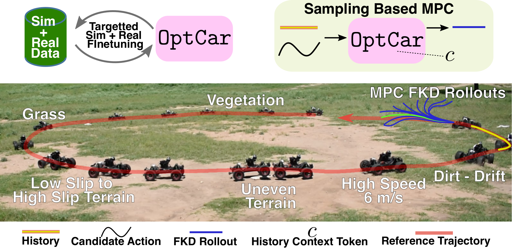
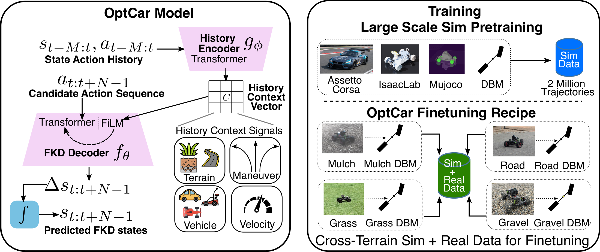

# OptCar

Torch DBM data generation, ROS2 bag conversion, and two-stage transformer training. [Paper](https://arxiv.org/abs/2607.13319).

<p align="center">
  
</p>

<p align="center">
  
</p>

**Code in progress.**

## Install and open the GUI

From this OptCar folder (all converter code and scripts live here):

```bash
bash scripts/setup_env.sh
conda activate optcar
python3 web_gui.py --bag-root /home/rwik/research/jumpracing/rosbags/corl26
```

Open **http://127.0.0.1:5050**. `setup_env.sh` creates the `optcar` Conda environment with Python 3.11, installs the single `requirements.txt` and OptCar, checks dependency compatibility and runtime imports, verifies tmux, then tests a small operation on **every visible NVIDIA GPU**. The requirements pin the official **Torch 2.11.0 / CUDA 12.8** GPU wheel, replacing an existing CPU-only build. The same GPU-enabled installation also supports CPU execution; there are no separate CPU/GPU requirements files. Runtime requirements also include bag readers, terminal progress, plotting and the GUI. The tmux executable is supplied by Conda/system setup.

To repair an existing CPU-only environment, rerun `bash scripts/setup_env.sh`. For manual installation inside the `optcar` environment:

```bash
python3 -m pip install -r requirements.txt -e '.[bags]'
```

CUDA builds require a compatible NVIDIA driver. Restart any running GUI after updating Torch or changing GPU visibility. See the [official PyTorch build options](https://pytorch.org/get-started/previous-versions/).

In **Synthetic raw bins**, **Collection device** lists each detected GPU as `cuda:0`, `cuda:1`, etc., with its name and total memory. The first available GPU is selected initially; CPU remains selectable. **Refresh GPUs** updates the list, preserving your choice when available. Each collection uses one selected device and its own tmux session; multiple collections with distinct run names can run concurrently on the same or different GPUs. This does not split a single collection across GPUs. CLI generation accepts the same indexed devices via `--device cuda:1`. Device indices follow Torch's visible ordering, including `CUDA_VISIBLE_DEVICES`; restart the server after changing that variable. Dataset builder has the same indexed GPU selector and defaults to the first visible GPU. ROS2 bag decoding remains on the CPU.

In **Device & DBM config**, enter a full YAML path and click **Load config** to inspect its parameters. Generation reads that file directly and saves to `<config folder>/<run name>/`; for `/data/mulch.yaml` and run `run_01`, the output is `/data/run_01/`. Both flat parameter YAMLs and OptCar's `params:` YAMLs are supported. Leave the path blank to use the saved terrain preset and the usual terrain collection folder. The dashboard's **Visualize** and **Use in builder** buttons open the actual output folder.

In **DBM calibration**, set both **DBM config folder** (full path) and **DBM config filename** (including `.yaml` or `.yml`) before loading or saving parameters. These fields start empty. **Save config** writes to exactly that location; use the resulting full path in synthetic generation.

`web_gui.py` calls the existing GUI entry point and accepts the same `--bag-root`, `--dataset-root`, `--host`, and `--port` options. Run `python3 web_gui.py --help` to see them. The `optcar gui` command remains available.

- **ROS2 bags → bins:** scan a folder recursively, inspect duration and topics, choose bags, and select an output folder. Conversion runs in the background with overall and current-bag progress, elapsed time, an estimated remaining time, results, and cancellation. Completed bins are retained on cancellation; refreshing the page reconnects to an active job while the server remains running.
- **Raw bin viewer:** open a dataset folder, nested bin folder, or single `.bin`. Expand the folder browser and click a file. Inspect world XY motion with zoom/pan, play or scrub through every sample, and view position, wxyz orientation, world linear/angular velocity, and commands with exact cursor values. Beside the world trajectory, two plots show commanded velocity versus measured forward body velocity, and the steering command. Use **Action plot time range → Around current** to set seconds before and after the selected sample; both action plots follow playback/scrubbing with the current sample at `0 s`. **Full recording** restores the complete time axis. Expand **Y-axis limits** to set independent velocity and steering minimum/maximum values; leave either limit blank for automatic scaling. Manual limits stay fixed while scrubbing or playing. These controls use the viewer timestep, and narrow windows read their samples directly rather than relying on the sampled overview. Forward velocity uses the auxiliary body twist when present, otherwise a full-quaternion rotation of the main bin’s world velocity. After conversion, **View raw bins** opens this tab with the output folder filled in; the folder remains editable.
- **DBM calibration:** the manual web estimator copied from WheeledLab. Defaults use its CORL26 AlphaTruck preset (`len_f = len_r = 0.245 m`), shared with the backend and `configs/dbm.yaml`. The left folder explorer shares the raw viewer's expandable tree, filtering, selection, and duration/sample metadata. Click a raw 15/17-column bin, scrub the current sample, set a prediction horizon and command delay, edit all 13 DBM parameters, and use **Set & Rollout** to overlay the predicted future in the current sample’s body frame. **Tune DBM** in the raw viewer opens that exact bin and sample. World-trajectory segment selection and YAML saving/loading, plus circle/figure-eight/Dubins/custom reference trajectories, are preserved. Aggregate comparisons are not exposed in the interface. Terrain presets use OptCar’s existing preset storage. **Automatic bag fitting** opens the separate, existing ROS2-bag workflow: bounded least squares fits selected parameters to measured one-step transitions only after **Fit DBM parameters** is clicked; dataset creation has its own tabs. **Back to manual bin tuning** returns to the manual tool.
- **Synthetic raw bins:** choose a saved terrain preset, timestep, run count/duration, batch size, command bounds/noise, seed and selected per-parameter ranges. This follows WheeledLab’s batched controller, analytical DBM environment and data collector: each run saves one float32 `[batch_size, duration/dt, 15]` bin in `data/`, plus WheeledLab metadata. **Visualize synthetic data** opens the output in the synthetic viewer; **Use in dataset builder** adds it as a source. Nothing runs until you click **Generate raw bins**.
- **Visualize synthetic data:** reuses the raw bin viewer and folder explorer, with a **Batch index (0-based)** selector for WheeledLab packed `[environment, step, feature]` bins. For batch size 32, indices `0` through `31` select the individual trajectories in each bin. Legacy OptCar files contain one trajectory, so they expose index `0`. Packed bins read their environment count from metadata or **Layout settings → Environment count**. Playback, the sample slider, world trajectory, body-forward velocity, steering, time ranges and Y-axis limits use the selected trajectory. Folder, layout and frame selection are retained separately for the raw and synthetic viewer tabs. Generation completion and each saved synthetic collection provide a direct **Visualize** button.
- **Dataset builder:** add real and synthetic raw bin folders, scan their expandable trees and select files. Set the processing GPU, file loading workers, history samples, future transitions, timestep, stride, splits and output folder, then **Review selected bins** and **Build dataset**. Saved synthetic splits are preserved; new real recordings are split as whole sessions. Preview split counts are estimated windows, not timesteps; the preview states the samples per window and window stride. Timestep mismatches are reported, without resampling. Standalone bins support explicit layout/timestep/environment overrides. The output can be loaded by the existing `FKDDataset` and training commands; set your training configuration's `datasets` paths to this output. The build starts in a dedicated tmux session; the **Dataset builds** dashboard shows device, session/attach command, window/bin progress, elapsed time, remaining time and errors, including after a GUI restart. Multiple builds can use distinct output folders and selected GPUs. No training starts from this tab.
- **Transformer evaluation:** existing checkpoint and trajectory comparison.

The raw-bin reader is copied and adapted from WheeledLab's `dbm_estimator/extractor.py`; plot grouping and multi-environment ordering follow `plot_sim_bins.py`. It reads 15/17-column float32 bins, detects timestep and environment count from metadata, and supports manual layout overrides for standalone files. Dataset config files are read as text without executing Python. Large files use memory mapping and a sampled overview; the current sample is read exactly, including the final row. Signal ranges cover the full recording, and nonfinite values appear as gaps with a warning. This viewer expects raw state/action bins, before training-window processing. The manual DBM tab uses these same raw bins. Its plots and handlers are copied from `wheeledlab_utils/dbm_estimator`, with reference generators copied from `wheeledlab_tasks/mppi`; all adapted code and the locally served Plotly asset are inside OptCar. A horizon of H steps shows the current state plus H future states, clipped at the recording end. Positive command delay uses earlier recorded commands; rollouts report an error when the delay exceeds available command coverage or the parameters produce nonfinite results.

## Raw ROS2 bags to bins

This first stage copies WheeledLab's raw converter into `optcar/datagen/wheeledlab_rosbag_converter.py`. Its `_align_asof`, quaternion normalization, `process`, `_stack_rows`, and raw dataset configuration conventions are retained. The reader is adapted to `rosbags`, with progress and cancellation callbacks; no ROS Python installation or WheeledLab imports are required. `raw_bags.py` handles discovery, selection, metadata, output paths and jobs. The GUI and terminal both call `convert_raw_bags`, which invokes the copied aligner and row stacker.

```bash
optcar scan-bags /home/rwik/research/jumpracing/rosbags/corl26
# Full metadata, including per-topic counts:
optcar scan-bags /home/rwik/research/jumpracing/rosbags/corl26 --json

# Convert selected recordings with an in-place terminal progress display:
bash scripts/bags_to_bins.sh /home/rwik/research/jumpracing/rosbags/corl26 \
  --select data-collect/road/v2.0-s0.0 data-collect/grass/v2.0-s0.0

# Omit --select to take every bag; --exclude accepts relative paths to omit.
# --output /path/to/bins selects a destination; otherwise ROOT's parent/bins.
# --config configs/raw_bags.yaml loads the same settings exposed in the GUI.
```

For the `corl26` root, the default output is:

```text
rosbags/bins/
  data/corl26/data-collect/road/v2.0-s0.0.bin
  data/corl26/data-collect/grass/v2.0-s0.0.bin
  metadata/
    dataset_config.py      # Compatible with WheeledLab's raw processor
    schema.json            # Dtype, dimensions, frame and column names
    conversion.json        # Source bag, settings, shape and topic metadata per bin
    last_job.json          # Complete, failed and cancelled results
```

Default raw bins are **float32 [T, 15]**: position (3), quaternion wxyz (4), world linear/angular velocity (6), commanded velocity and steering (2). Every row retains its recorded command. The optional 17-column mode adds the unshifted command pair, matching WheeledLab's `include_cmd_vel` layout. This raw stage does **not** generate training windows or assign splits; the Dataset builder does that separately. The existing `optcar convert` command also remains available.

New conversions also read `/super_odometry/twist` and save its six linear/angular velocity channels in `aux/<same relative path>.bin`. This preserves the recorded body twist separately from the main bin’s world twist. `conversion.json` links each companion and records frame IDs, shape, timestep, start time, and missing values. Auxiliary samples use the same bag timestamps and sample-and-hold grid as the main bin, without shifting commands or trimming the main recording. Before/after auxiliary coverage, missing values are stored as NaN and displayed as gaps. Missing auxiliary topics do not block conversion. The viewer only lists main `data/` bins; training inputs remain 15/17 columns. Existing bins work with derived body velocity; select overwrite on the bags you want to reconvert with auxiliary data. The GUI’s **Auxiliary data** setting and CLI `--aux-twist-topic` choose another body twist topic; an empty name disables auxiliary output.

Defaults match WheeledLab: `/super_odometry/pose`, `/super_odometry/twist_wf` in the world frame, `/cmd_vel`, bag timestamps, 0.02 s timestep, zero action shift, and sample-and-hold alignment over the shared topic time range. Positive action shift applies commands later. Body-frame velocities can optionally be rotated into world coordinates. Maximum topic gaps are recorded in the metadata; raw alignment keeps WheeledLab's forward-fill behavior across gaps.

Existing bins are protected unless `--overwrite` (or its GUI checkbox) is selected. Overwrite replaces only selected outputs. Outputs are written atomically, and simultaneous conversions to the same destination are rejected. Different settings require a new destination so sampling rates and schemas cannot be mixed. Missing/malformed metadata and missing topics are shown per bag; source metadata is never repaired automatically. Missing metadata can be regenerated with `ros2 bag reindex /path/to/bag` in a suitable ROS environment.

Run the integration checks with:

```bash
PYTEST_DISABLE_PLUGIN_AUTOLOAD=1 python -m pytest -q tests/test_raw_bags.py tests/test_raw_bins.py
```

The flag avoids unrelated ROS pytest plugins when your shell has sourced ROS. Install test dependencies with `pip install -e '.[dev]'`.

## Synthetic raw bins and dataset assembly

Use tab **04 Synthetic raw bins**, followed by **05 Dataset builder**. DBM calibration stays in tab **03**. The builder uses the existing FKD writer and WheeledLab's Torch processing path: load batched `[environment, time, feature]` bins, reject invalid whole trajectories, move every valid trajectory in one input bin to the selected GPU, create windows with `unfold`, apply the copied quaternion continuity and world/body/delta transforms, then transfer the processed file to the CPU for disk writing. This follows `RawDatasetProcessor._process_single_file` in WheeledLab. Its fixed-size batch saving combines windows across environments into `shard_windows` windows per output bin (1024 by default), rather than writing one bin per trajectory. Raw inputs are referenced in the manifest instead of duplicated. Output batches finish at each input recording boundary to preserve its saved split and allow whole-recording resume; WheeledLab can carry remaining windows across files. Whole-file processing requires enough GPU memory for all windows from that input bin. The quaternion filter keeps the original sequential sign decisions; unused flip-count logging no longer synchronizes CUDA at each timestep. Existing per-session splits, the 42-column feature layout, manifests and resumability are preserved. Builds started with the older per-environment writer can resume: their committed trajectories are skipped and remaining trajectories use batched output. Older files are retained. File loading uses WheeledLab's `ThreadPoolExecutor` approach with 16 workers by default; set **File loading workers**, YAML `workers`, or CLI `--workers` to change the count. A bounded queue overlaps loading with GPU processing and preserves input order, file IDs and session splits. Frame conversion uses the copied shared math utilities; window saving follows WheeledLab’s batched output path. WheeledLab's 8 scatter threads belong to its separate shuffled-output path.

Raw states are `[position(3), quaternion wxyz(4), world linear velocity(3), world angular velocity(3)]`, followed by velocity/steering commands. Both 15-column bins and 17-column real bins are supported; the extra two unshifted command columns are diagnostics. Processed windows contain world (13), body (13), delta (13), commands (2) and the existing vehicle/file ID (1): **42 columns**. Vehicle ID defaults to the selected file index, as in WheeledLab, and can be overridden per source.

The current sample is `history_steps - 1`. Body states use that sample's full quaternion and position. Delta position/orientation uses the previous sample's frame; delta velocities are absolute velocities rotated into each sample's own body frame. Quaternion continuity is applied separately to world and relative body orientations per window, without forcing positive w. WheeledLab's `future_horizon` includes the current sample; OptCar's `future_steps` counts transitions, so a future setting of 50 corresponds to WheeledLab `future_horizon=51`. As in WheeledLab, an environment trajectory containing NaNs is skipped; OptCar also rejects infinities and zero quaternions. Commands stay aligned to their recorded sample, including the final row for imported raw bins. Synthetic collection now uses WheeledLab’s post-step state/action logging: each row stores the state after applying that row’s command. It does not prepend the initial state or append a zero command. Legacy collections remain readable and are not rewritten.

The added backend manages selected sources, manifests, progress, and the chosen output folder. Selecting a folder that contains your raw input folders creates a new `processed/` folder inside it: selecting `corl26/sim/` with raw inputs `sim/grass`, `sim/road`, and `sim/mulch` builds into `sim/processed/`. A new folder inside an input folder or an existing folder containing unrelated files is also supported. Existing source bins are never modified; only conflicts with files the builder would write are rejected. Repeating a build with unchanged sources/settings resumes it; changed inputs require a new output folder. Subsequent input scans exclude the builder's own outputs. Train/validation/test split membership lives in each manifest, rather than splitting overlapping windows randomly. Saved synthetic episode IDs can repeat across collection folders because they derive from settings and run index. The builder accepts distinct input files and preserves their saved splits; selecting the same file twice is rejected. Source explorers display the actual validation error beside unavailable bins. Using the same base seed and settings on another GPU repeats the seeded commands and parameter samples; use a different base seed for additional independent collections.

Terminal equivalents share the same backend:

```bash
optcar generate --terrain road --run raw_v1 --raw-only
# Edit configs/dataset_builder.yaml with your source folders and window settings:
optcar build-dataset --config configs/dataset_builder.yaml --device cuda:0 --workers 16
```

Generation saves raw bins; processing happens in the Dataset builder. `--raw-only` remains an accepted compatibility flag. Both commands return their tmux session and attach command immediately. Attach to monitor progress in place; use the same `--dataset-root` as the GUI to share its dashboard registry. Use a new run name when switching from legacy collections: the output guard rejects mixing layouts or collection settings.

Optional parity tests read the local WheeledLab source without importing ROS/Isaac/CuPy. Set `WHEELEDLAB_SOURCE` to its `source` directory when it is not next to OptCar. They compare processed states/actions and DBM RK4/rollouts against the reference routines. Tests create temporary fixtures only.

## Prepare data from the terminal

Set your bag paths and edit the topics in `configs/rosbag.yaml`:

```bash
TRAIN_BAG=/data/road_train
VAL_BAG=/data/road_validation
TEST_BAG=/data/road_test

optcar topics "$TRAIN_BAG"
optcar convert "$TRAIN_BAG" --terrain road --split train
optcar convert "$VAL_BAG" --terrain road --split val
optcar convert "$TEST_BAG" --terrain road --split test
optcar fit "$TRAIN_BAG" --terrain road
optcar generate --terrain road --run raw_v2 --runs 10 --batch-size 32 --device cuda:0
```

Repeat for other terrains. Use separate bags for each split. `configs/datagen.yaml` controls Bézier velocity, random-walk steering, noise, run duration and batch size. Replace `cuda` with `cpu` if needed.

## Train

Supply generalist data in `datasets/generalist_dataset/` first; it is initially empty. See [dataset format](docs/dataset_format.md) for existing FKD bins.

```bash
# Generalist → specialist (real + synthetic data)
optcar train --config configs/train_generalist.yaml --device cuda
optcar train --config configs/train_specialist.yaml --device cuda
```

Final checkpoint: `checkpoints/film_specialist/specialist_best.ckpt`.

For cross-attention, use a separate checkpoint pair:

```bash
optcar train --config configs/train_generalist.yaml --architecture cross_attention \
  --output checkpoints/cross_generalist --device cuda
optcar train --config configs/train_specialist.yaml --architecture cross_attention \
  --checkpoint checkpoints/cross_generalist/generalist_best.ckpt \
  --output checkpoints/cross_specialist --device cuda
```

## Evaluate

```bash
optcar evaluate --checkpoint checkpoints/film_specialist/specialist_best.ckpt \
  --datasets datasets/syn_data/terrains --real-only
```

Use `optcar <command> --help` for options, including training resume and prediction export.

## Code

- `optcar/models/`: `dynamic_bicycle.py`, `dbm_calibration.py`, `fkd_transformer.py`.
- `optcar/datagen/`: `dbm_to_dataset.py`, `rosbag_to_dataset.py`.
- `optcar/dataset.py`: binary format, writer, loader, and balanced sampling.
- `optcar/train.py`, `optcar/evaluate.py`: training and evaluation.
- `optcar/gui/`, `optcar/utils/`: web interface and shared helpers.

Synthetic collection reuses copies of WheeledLab’s `ParametricOpenLoopController`, `ParamRandomizer`, parameter dataclasses, `State_struct_torch`, and `DataCollector`. The analytical environment reset/step methods and Torch RK4 equations follow the reference. DBM parameters come from your saved terrain preset; zero initial velocity, grid spacing, action normalization and the default 10 m/s² lateral acceleration cap match its analytical simulator. Parameter values are shared across each batch; the default keeps them fixed across runs, with `commands.resample_params_each_run` available as in WheeledLab. `commands.parameter_ranges` accepts the reference’s uniform/normal numeric ranges for supported physical/control parameters. A run with 32 trajectories, 10 seconds and dt=0.02 saves 32 × 500 × 15 × 4 = 960,000 bytes (937.5 KiB). Ten runs produce ten files and 320 trajectories.

The synthetic tab’s **Domain randomization** editor enables individual DBM physical parameters, control limits, starting position/heading, actuator gains and deadband endpoints. Unchecked parameters retain the saved terrain values. Uniform inputs map to `[min, max, uniform]`; Normal inputs map to `[mean, std, normal]`, using the copied WheeledLab `ParamRandomizer`. Check **Resample vehicle parameters each run** to sample a new shared parameter set per run. The original YAML `commands.parameter_ranges` remains available for terminal collection.

The synthetic setup is a compact, full-width grid: collection settings, command bounds/noise and GPU selection sit above individual parameter cards. Configure ranges directly in OptCar; no external repository or YAML path is needed. `velocity_bias` and `steering_bias` use separate per-environment uniform sampling before action normalization; applied biases and resolved vehicle parameters are saved for each run. Model-level `throttle_bias` and `steer_pos_bias`/`steer_neg_bias` remain distinct and use the copied deadband/gain/bias processing.

The default **Stretch Bézier curves to both command bounds** retains WheeledLab’s min/max normalization: every nonconstant mean curve touches both bounds. Uncheck it (`commands.bezier_full_range: false`) to retain its original randomly sampled Bézier control points, skipping only that normalization for Bézier curves. The same noise, clipping, seeding and other curve methods remain in use. Noise or command biases can still produce samples near a limit. Changing either ranges or command generation settings requires a new run name.


Synthetic generation now starts a separate **tmux session per collection** from both the GUI and `optcar generate`. The command returns the session name and `tmux attach -t ...` command immediately. The worker uses the same collector, snapshotted DBM parameters, command settings and selected device. Multiple collections can run concurrently with distinct run names; an active collection reserves its output folder.

The synthetic tab’s **Generation runs** dashboard shows all managed collections, session names, attach commands, progress, elapsed/remaining time, device and output folder. It reconnects after a page refresh or GUI restart. Completed collections provide **Visualize** and **Use in builder** actions. **Cancel** or Ctrl+C in the tmux pane stops the collector safely, keeping completed bins; Ctrl+B then D detaches without cancelling. Worker progress updates in place without scrolling. Finished tmux panes remain available for inspecting results/errors; close them with `tmux kill-session -t SESSION` when no longer needed. Job configuration/status records stay under the dataset root’s `.generation_jobs/`. Older collections remain in **Terrain collections**.

`tmux` is a system/Conda tool, included in `environment.yml` and checked by `scripts/setup_env.sh`; Python packages still use the single `requirements.txt`.
